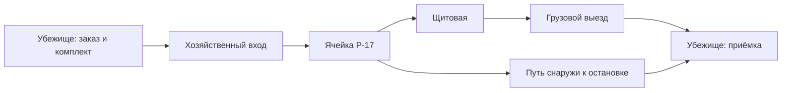

# RING — вступление «По ведомости»

Редакция от 2 октября 2026 года. Это проект вступительной миссии, ещё не реализованной в игре.
Основа: текущий Git, переданный мастер-контекст и [предложение кампании](world_and_story.md).
Владелец одобрил основу задания и базу в котельной у насыпи, зона 5. Постановка, диалоги,
баланс и развилка с грузом остаются предложениями для согласования.

После ответа владельца начало включено в [новую структуру кампании](campaign_outline.md).
Антон ушёл четыре дня до прибытия игрока; просьба о поиске возникает после знакомства
через другие работы. [Вступительный экран и проверка сценария](opening_and_story_review.md)
не объявляют первый заказ. Игрок осматривается и сам подходит к продавцу; работа принимается
в разговоре. Сюжет сначала согласуется текстом, игровые файлы не меняются.

Уточнения владельца уже обязательны: **все миссии и обучение проходятся соло, вдвоём или
втроём. В коопе задание и его прогресс общие: действие любого участника засчитывается всем.**
Это правило распространяется на последующую кампанию, а не только на вступление.

## 1. Что начинается после «Новая игра»

Начало — короткий оплаченный выход за конкретным оборудованием. Игрок знакомится с Сергеем,
готовится в убежище, проходит служебную часть первого этажа ТЦ, выносит заказ и разбирается
с его приёмкой. Первый рейд должен занять ориентировочно 12–16 минут, всё вступление с
подготовкой и возвращением — 18–22 минуты при первом прохождении. Это цель для проверки
игрой; опытную группу задерживать до этих сроков не нужно.

Вводный экран объясняет положение игрока. Работа, адрес и способ вернуться становятся
известны после добровольного подхода к продавцу и принятия заказа. Обучение появляется
в момент применения механики. Развёрнутые сведения об участниках вывоза остаются
для следующих эпизодов.

В форме новой игры, кроме имени сохранения, доступны:

- **Одному** — создать сохранение и начать в убежище.
- **Создать группу** — создать сохранение, открыть встречу на двух или трёх игроков и начать
  подготовку вместе. Можно выйти и одному, если никто не подключился.
- **Присоединиться** — создать своё сохранение и подключиться к встрече друга. Уже имеющийся
  профиль можно выбрать явно; новое сохранение не должно заменять его автоматически.

На этом этапе используется существующее подключение к хосту; приглашения через внешнюю
платформу не предполагаются. Весь путь доступен из «Новая игра», без обязательного одиночного
рейда перед коопом. Встреча проходит в стартовой комнате, где уже можно двигаться, разбирать
снаряжение и осматривать обстановку. Выход начинает хост после обычной готовности группы.
Готовность — согласие начать рейд, а не экзамен по действиям каждого игрока.

«Подсказки управления» — личная настройка. Их можно выключить с самого начала. Сюжет и общие
цели от этого не меняются. До запуска первого рейда одиночную игру можно превратить во встречу
и наоборот; уже пройденный разговор повторять не требуется.

## 2. Заказ и его место в истории

Герой приехал на частную работу; конкретный первый вынос предлагает Сергей после знакомства.
В коопе за него берётся небольшая рабочая группа. Обязательного родства, общей военной части
или трёх разных сюжетных биографий нет.

Сергей Михайлович принимает груз и обеспечивает доступ к месту подготовки. Заказ пришёл через
него, но оборудование он лично не проверял. В ведомости указаны небольшой электропривод,
номер **Р-17**, ячейка возврата в хозяйственном складе ТЦ и отметка **«к вывозу»**. Этого
достаточно для обычной работы, но недостаточно для уверенного вывода о собственнике.
До выхода названы две части цены: выполненный вынос и окончательная сдача получателю.
Остановка приёмки ради сверки не делает уже выполненный вынос бесплатным.

На узле осталась ремонтная бирка: **«Заказ на ремонт: Р-17. Клиент: Павел Досов.
Проверен. К выдаче»**. Она становится видна при сверке, до сдачи заказа. Р-17 — номер
ремонтного заказа; маркировку конкретного узла сверяют отдельно. Сергей не может объяснить
чужой ремонт по памяти. При знакомстве Павел объяснит, для какой арки готовил привод.

Привод уже снят и лежит на хранении. Игрок не обязан разбирать действующие ворота во время
обучения. Это **другой узел**, не двигатель грузового выезда текущего рейда: включение
`dock_gate` и вынос Р-17 не противоречат друг другу.

Упаковку может перенести один человек в обычном рюкзаке, сохранив возможность пользоваться
оружием. Её размер и масса должны оставлять место для боезапаса и медицины базового комплекта.
Дополнительная добыча создаёт выбор по вместимости; сам заказ не требует второго носильщика,
тележки, отдельного транспорта или улучшенного рюкзака.

Заказ объясняет первый выход и знакомит с вопросом принадлежности вещей. Его исход связывается
с дальнейшей кампанией: после продажи придётся искать вывезенный узел или замену; после
отложенной сдачи — установить владельца и договориться о применении сохранённого оборудования.
Оба результата приводят к знакомству с Павлом, но по разным причинам.

## 3. Начальная сцена: приёмная комната

Игрок получает управление стоя возле тайника в убежище. Сергей у рабочего стола сверяет
накладную. На соседней полке лежат пачки патронов с синей изолентой — существующая деталь его
сюжетной линии. Сейчас она воспринимается как способ упаковки; её значение раскроется позже.

В комнате слышны вытяжка, движение стула, перелистывание бумаги и окончание обычного
разговора о поставке. Первый диалог начинается только по взаимодействию у стола.
Камеру не поворачивают за игрока. Он может сначала осмотреть тайник и настроить управление.

Короткий разговор:

> **Сергей:** В возвратной ячейке привод. На коробке Р-17. Номер на самом узле проверь тоже.
>
> **Сергей:** К грузовому выезду близко. Он без питания; щитовая рядом. Если не получится —
> остановка у главной площади открыта.
>
> **Сергей:** На ведомости цена. Вернёшься — сверим и рассчитаемся.

В коопе Сергей обращается к тому, кто начал разговор. Реплики слышны находящимся рядом;
содержание заказа сразу появляется в общем журнале. Напарник может прочитать его позднее.
Чужой разговор не открывает на весь экран окно каждому и не останавливает управление.

На схеме отмечены вход, хозяйственный склад, щитовая и два выхода. На общей схеме района
видны пять игровых зон; подробности пока есть только у знакомого маршрута ТЦ. Для рисунка
используется кольцевой ТЦ, а не прямоугольник с ориентировочной карты владельца.

Сергей уже обеспокоен Антоном, но не доверяет незнакомому исполнителю опасные сведения.
Первый разговор остаётся рабочим. После Р-17 предлагаются возврат зарядного блока котельной
и проверка проезда с небольшой доставкой Павлу. По результатам этих договорённостей Сергей
обращается с личной просьбой. Он искал брата через знакомых до появления игрока.
Найденный раньше достоверный след нельзя игнорировать ради номера задания: он сам даёт
основание для обращения. Поиск не зависит от продажи Р-17 и не покупается баллами доверия.
Вступление не добавляет к отсутствию Антона несколько обязательных игровых суток.

## 4. Подготовка: вещи ещё находятся в тайнике

Текущий новый профиль получает деньги и предметы в тайник, а экипировка и рюкзак пусты.
Вступление должно показать это явно: стартовая точка стоит рядом с тайником, первая подсказка
предлагает взять оружие, совместимый магазин, боеприпасы и перевязку.

В окне снаряжения есть короткий рекомендуемый комплект, собираемый из уже существующего
стартового набора. Игрок может собрать его одной командой или вручную. Снаряжение берётся
из его тайника; на каждого напарника предусмотрен его собственный стартовый набор.

Перед выходом показываются проверяемые факты: есть ли оружие, подходящий магазин, патроны
в нём и средство остановить кровотечение. Отсутствующее называется прямо. Подсказка по
снаряжению магазина появляется рядом с нужной операцией, а не в отдельном длинном руководстве.

Подготовка не становится цепочкой «пусть каждый выполнит все операции». Вступительная цель
уже общая; личная проверка комплекта помогает конкретному игроку. Если напарник разобрался
раньше, остальным остаются доступны подсказки. Запуск без оружия требует заметного личного
предупреждения; чужая собранная экипировка не должна молча означать, что снаряжён весь отряд.

Проверку магазина и прицеливание можно попробовать до выхода. Стрелять в помещении убежища
ради обязательной галочки не требуется. Настройку прицелов, обвесы, ПНВ и сложную медицину
в эту подготовку не включать.

## 5. Первый рейд: последовательность сцен

### 5.1. Подход к служебному входу — около двух минут

Появление — снаружи, на северо-восточной хозяйственной стороне ТЦ. Перед игроком видна дуга
фасада и служебная дверь; маршрут не проходит через единственный северный вход посетителей.
Вдалеке слышен обычный дорожный поток. Во дворе гораздо тише. Свет заката, несколько тёплых
ламп и длинная тень здания соответствуют базовому времени игры.

Первый участок даёт безопасно пройтись, изменить темп движения, открыть схему и осмотреть
дверь. На входе — читаемая табличка с названием склада из заказа. Движение к цели направляют
номер, свет и форма прохода. Точка на карте показывает нужную часть здания; готовой линии
через каждую дверь нет.

Цель **«Войдите в служебную часть ТЦ»** закрывается, когда её достиг любой участник. Вход
остаётся открытым для остальных. В соло игрок проходит тот же путь.

### 5.2. Чужая работа за стеной — около двух минут

Внутри меняется акустика: бетонный пол, звук двери, гул вентиляции. Через соседний грузовой
шлюз сначала слышен короткий металлический удар, затем передвигаемый ящик. В просвете двери
можно увидеть человека, который разбирает складские вещи. Второй работает со стороны двора.

Оба существуют в мире с начала рейда. Их маршрут позволяет наблюдать участок из укрытия.
До возможного обнаружения игроку дают увидеть, откуда приходят шаги и куда можно отойти.
Служебный коридор за стеной позволяет обойти шлюз. Паузы в работе достаточно длинные,
чтобы пройти одному без спринта и без выстрела.

Здесь работают обычные зрение и слух AI. Мародёры не узнают позицию по принятию квеста,
подбору груза или смене этапа. Не попавший в поле зрения тихий игрок остаётся незамеченным.
Выстрел, звон металла или разбитое стекло дают противнику причину расследовать шум.

Убийство не является целью. При первом прицеливании появляется краткая личная подсказка.
При реальном контакте объясняются укрытие и перезарядка; бой не ставится так, чтобы игрок
обязательно получил ранение. Дверь и соседнее помещение дают возможность разорвать контакт.

### 5.3. Ячейка возврата — три-четыре минуты

Нужная ячейка стоит в хозяйственной части склада гипермаркета. У неё есть место приёмки,
использованные прокладки, старая ремонтная бирка и два похожих узла. Один — разобранный
корпус, второй — заказанный привод. Это участок обычной работы склада, который позже
перестали обслуживать полностью.

Ведомость и маркировка позволяют выбрать предмет. Осмотр нужного узла показывает Р-17 и
бирку Павла. Имя доступно всем в журнале после одного осмотра. Ошибочный корпус не вызывает
провала: осмотр сообщает, что номер и состояние не подходят, оставляет предмет на месте.
Реалистичный объект не обязан превращаться в ловушку на необратимый ошибочный клик.

Цель **«Сверьте номер привода с ведомостью»** сменяется на **«Заберите привод Р-17»**.
Подбирать его может тот же игрок или напарник. В мире и инвентарях существует один экземпляр.
Его появление в рюкзаке одного участника закрывает цель всей группе.

Рядом есть небольшая необязательная добыча. Она даёт практический выбор: оставить свободное
место под заказ, переложить часть найденного напарнику или отказаться от лишнего. В соло
с заказом помещается минимальный необходимый комплект; выбрасывать последний магазин
для продолжения сюжета не требуется.

При подборе нет сирены, запирания входа или внезапного появления врагов. Вес и занятые клетки
видны в обычном интерфейсе. У выхода из ячейки слышны те же люди, которых группа уже могла
заметить. Меняется задача игрока: теперь у него есть вещь, которую нужно сохранить.

### 5.4. Обратный путь — три-четыре минуты

Ближайшая точка — выезд грузового двора. Из входного брифинга уже известно, что ей требуется
питание. В щитовой видны подпись соответствующей линии, рубильник и состояние цепи.
Включение даёт щелчок, включённый индикатор и звук работающего привода ворот. От него могут
отреагировать люди поблизости, если услышат; отдельная волна противников не создаётся.

В соло можно сначала включить линию, затем забрать груз. Можно сделать это и на обратном
пути. Рубильник не требует, чтобы кто-то постоянно его держал. Если напарник включил его
раньше, цель учитывает уже работающее состояние и не просит повторить взаимодействие.

Второй путь — вернуться наружу и идти к открытой остановке у главной площади. Он длиннее,
часть подхода проходит по открытому месту, зато не требует питания. При сорванном тихом
проходе им всё ещё можно воспользоваться. Игра принимает груз через любую действующую
точку эвакуации; выбор остановки не считается неправильным прохождением обучения.

В коопе удобно поручить одному рубильник, другому груз, третьему наблюдение за двором.
Это добровольное распределение. Те же действия доступны одному последовательно, а вдвоём
можно обойтись без отдельного наблюдателя. Упаковку разрешается передать, выложить и подобрать
повторно обычными действиями инвентаря; закреплённой роли носильщика нет.

### 5.5. Эвакуация — время определяется существующей системой

Общая цель — **«Эвакуируйтесь с приводом»**. Она закрывается по факту успешного выноса
реального предмета кем-то из участников. Подход к зоне без груза ещё не означает доставку.

Используются текущие правила рейда: участник в открытой зоне запускает общий отсчёт;
когда все живые находятся в открытых зонах, действует короткий отсчёт точки. Можно уходить
через разные доступные выходы. В текущем балансе общий предел — три минуты, отсчёт Dock —
десять секунд. Во вступлении эти значения отдельно не переписываются.

При первом входе в точку появляется понятная подсказка о времени и оставшихся участниках.
В коопе преждевременно подошедший разведчик может выйти из зоны, чтобы не торопить носильщика;
общий отсчёт сбрасывается, если открытые зоны опустели. В соло достаточно находиться в точке
с грузом до завершения её короткого отсчёта.

Успех доставки сразу фиксируется для всей группы. Оставшиеся в рейде продолжают завершать
свой выход; интерфейс дополнительно показывает их личный статус эвакуации. Общая цель
приёмки у всех одна. Приёмная сцена начинается после разрешения исхода рейда для участников,
а не пока один из них ещё отбивается у ворот.

Если носильщик погиб, груз остаётся на теле или в доступной добыче. Любой оставшийся участник
может забрать его и завершить доставку для всех, включая погибшего. Убийство носильщика не
уничтожает предмет и не отменяет уже известный группе номер.

## 6. Возвращение: проверить приёмку

При подтверждённой эвакуации Р-17 один раз переходит из инвентаря носильщика в общую ячейку
приёмки. В убежище он показан на приёмном столе. Оформить результат может любой участник,
даже если носильщик уже отключился. До завершения приёмки узел учитывается как груз заказа,
его нельзя случайно продать через обычное окно торговли. Перенос и факт доставки сохраняются
вместе; загрузка не оставляет одновременно экземпляр в личном рюкзаке и на столе.

Сергей сверяет номер и замечает ремонтную бирку по сообщению игрока либо по самому предмету.

> **Сергей:** Р-17. Сходится.
>
> **Игрок:** На бирке клиент — Павел Досов. Ему выдавать?
>
> **Сергей:** Я эту бирку не видел. В списке он к вывозу.
>
> **Игрок:** Чей список?
>
> **Сергей:** От приёмщика. Я могу отдать по нему. Или придержать до сверки.

Два явно подписанных результата:

- **«Сдать по ведомости»** — Сергей принимает груз для отправки, выплачивается оговорённая
  сумма. В журнале остаётся бирка Павла. Позже группа увидит результат собственного вывоза.
- **«Оставить до сверки»** — узел остаётся в общей ячейке убежища, оплачивается оговорённая
  часть за выполненный вынос; окончательный расчёт ждёт проверки. Появляется основание
  связаться с Павлом. Учебная миссия тоже завершается.

Выбор делает любой участник через отдельное действие приёмки; чтение реплики не выбирает
его автоматически. Принятое решение одно для группы и сразу видно остальным. Для вступления
нужны два сохраняемых исхода и учёт движения самого груза. Подробные последствия, разница
следующих работ и отправка с водителем описаны в [каркасе кампании](campaign_outline.md#5-развилка-р-17-что-именно-меняется).
Они ещё не утверждены; две отдельные кампании не предлагаются.

Вознаграждение за один поставленный узел — один бюджет заказа. При первом прохождении в
соло он целиком игроку, вдвоём или втроём делится поровну. Если помогает уже прошедший эпизод
игрок, бюджет делится между участниками без отметки о полученной награде. Список получателей
определяется на старте рейда, погибший сохраняет свою долю. Сумма задаётся в `Balance` при
реализации. Знание маршрута, завершение вступления и доступ к продолжению одинаковы для всех
при любом из двух результатов. Личная добыча и число успешных личных эвакуаций не копируются
напарникам.

После приёмки открывается следующая обычная работа. Личная просьба Сергея возникает
по итогам знакомства через две дополнительные работы, не сразу после первого выноса.
Группа выбирает, когда продолжать; обязательного сна и покупки уровня доверия нет.

В итоговой записи перечисляются только установленные события: какой узел вынесен, через
какую точку ушёл носильщик, произошёл ли бой, что выбрано при приёмке. Бирка указывает на
спорное назначение, но ещё не доказывает мошенничество Сергея или преступление заказчика.

## 7. Цепочка целей и зачёт

Подготовка, наблюдение и подсказки не добавляют скрытых обязательных галочек к этой цепочке.

| № | Общая цель | Достаточное условие | Что получают остальные |
|---|---|---|---|
| 1 | Получите ведомость заказа | Любой участник принимает заказ у Сергея | Заказ, карта и текст брифинга в общем журнале |
| 2 | Войдите в служебную часть ТЦ | Любой участник достигает входного участка | Цель выполнена, следующий ориентир |
| 3 | Сверьте номер привода | Любой участник осматривает нужный узел | Номер и ремонтная бирка в журнале |
| 4 | Заберите привод Р-17 | Подтверждённый хостом предмет находится у любого участника | Общий статус груза и его носильщик |
| 5 | Подготовьте путь выноса | Работает грузовой выезд **или** достигнут подход к открытой остановке | Доступный вариант отхода; менять его по пути разрешено |
| 6 | Эвакуируйтесь с приводом | Любой участник успешно вынес Р-17 | Общий факт доставки, независимо от личного исхода |
| 7 | Решите вопрос с приёмкой | Любой участник сдаёт узел или оставляет его до сверки | Завершённое вступление и один общий сюжетный исход |

Цель 5 проверяет состояние выхода, а не нажатие определённой кнопки. Цели 3–5 допускают
действия заранее: подготовленный выход и уже сверенный узел учитываются после появления
соответствующей цели. Подбор правильного предмета также сверяет его номер; игра не заставляет
выкладывать груз ради запоздавшего пункта осмотра. Вынос предмета через другую открытую
точку закрывает доставку даже без посещения рекомендованного выхода.

Это последовательность предъявления задачи. Она не должна запрещать взаимодействие с
объектами следующего этапа или терять уже произошедшее событие.

## 8. Постановка на существующей карте

Вступление занимает часть зоны 1. Городской пояс, промзона, периметр и частный сектор остаются
самостоятельными дальнейшими направлениями; изображать все пять зон в первом рейде не нужно.
Начальная комната использует текущее убежище. Возможный будущий перенос базы в зону 5
из предыдущего предложения не является условием реализации вступления.

На 1F уже есть подходящие помещения и объекты:

| Опора | Текущее место | Роль во вступлении |
|---|---|---|
| `hyper_st` | Склад гипермаркета, a −58…−43.5°, r 109…121 м | Ячейка возврата и небольшая дополнительная добыча |
| `svc_1` | Служебный коридор, r 121…125 м | Подход и обход грузового шлюза |
| `loading_bay` | Грузовой шлюз, a −32.5…−27.5° | Источник слышимой деятельности, видимый опасный проход |
| `electrical` | Электрощитовая, a −27.5…−19.5° | Подготовка короткого выхода |
| `Interactables/DockGateSwitch` | a примерно −23.5°, r около 120 м | Существующий `dock_gate` |
| `Extractions/Dock` | a −30°, r 165 м | Короткий вынос |
| `Extractions/Bus` | Северная площадь, позиция (0, 0, −190) | Более длинный открытый выход |

Это опоры планировки, а не утверждение, что готовая постановка уже существует. Требуется
проверить реальные проёмы и обзор, поставить входную точку, ячейку, подписи и исходные позиции
людей. Координаты ячейки и входа закрепляются после прохода в блокауте. Нельзя назначить
маршрут сквозь стену только потому, что на схеме рядом два помещения.

Размеры идеального кольца, шесть секторов и границы открытой половины сохраняются. Обход
использует действующие проходы внутри открытых секторов. Закрытые сектора и верхние этажи
видны как дальнейшее пространство; обучающая миссия не открывает их раньше прогрессии.

Для первого рейда нужен отдельный сценарий размещения на базе `f1_ring`, с управляемыми
начальными позициями и маршрутом двух противников. Полная случайная заселённость, сброс
припасов, посторонние сюжетные места и неожиданный отказ генератора не должны попадать
в эту постановку. Необходимые источники событий и предметы определяются сценарием рейда.
Зрение, шум, оружие, двери, медицина и эвакуация продолжают работать по обычным правилам.

## 9. Обучение в ситуации

| Момент | Личная подсказка | Общий результат миссии |
|---|---|---|
| Тайник | Перенос и экипировка, подходящий магазин и патроны | Полученный заказ остаётся общим; комплект у каждого свой |
| Перед выходом | Проверка снаряжения и магазина | Отсутствует требование повторить все операции каждым |
| Подход | Движение, темп, схема маршрута, взаимодействие с дверью | Вход одного продвигает общую цель |
| Шум за стеной | Направление звука, тихое движение и укрытие | Решение обойти или вступить в бой не меняет условие заказа |
| Прицеливание и контакт | Прицел, перезарядка; при необходимости отступление | Убийство не требуется |
| Ячейка | Осмотр, поиск, размер предмета, свободные клетки | Осмотр и подбор одним засчитываются всем |
| Реальное ранение | Как остановить имеющееся кровотечение | Чужое лечение не закрывает интерфейс пострадавшего |
| Эвакуация | Условия точки, время, оставшиеся участники | Вынос одним засчитывается всем |
| Приёмка | Передача груза, оплата и оставшаяся запись | Один выбранный результат для всей группы |

Подсказка показывается по реальному затруднению и текущим привязкам управления. Сергей не
произносит клавиши. Текст не закрывает противника или инвентарь, одновременно активна одна
короткая подсказка; пояснение можно раскрыть самому. При повторной попытке уже освоенные
действия не объясняются заново, но справка остаётся доступной.

Продвижение общей цели и освоение управления хранятся отдельно. Напарник может закончить
осмотр, пока новичок учится пользоваться дверью. Новичок получает новый общий этап и
продолжает видеть нужную ему подсказку. Для проверки обучения используется также соло,
чтобы успех опытного напарника не скрывал непонятный интерфейс.

## 10. Соло, двое, трое: один эпизод

| Действие | Соло | Вдвоём | Втроём |
|---|---|---|---|
| Осмотр и получение груза | Один последовательно | Можно разделить | Можно разделить |
| Подготовка выхода | До подбора или после него | Один открывает, второй несёт | Третий может наблюдать двор |
| Обход людей | Полный путь доступен одному | Напарник не обязателен для отвлечения | Нет обязательной третьей позиции |
| Вынос | Один обычный рюкзак | Один груз на группу | Один груз на группу |
| Зачёт | Действия единственного участника | Действие любого — обоим | Действие любого — всем троим |

Первую постановку делать с одинаковыми двумя противниками для всех трёх составов. Напарники
сами дают преимущество и возможность прикрытия; компенсировать её удвоенным или утроенным
числом врагов во вступлении не требуется. Прочность противников и урон не зависят от состава.
После игрового прохода можно корректировать маршруты и длительность безопасных промежутков,
сохраняя возможность одиночного обхода.

Для всех следующих миссий действует тот же принцип: количество обязательных улик, деталей
и действий определяется задачей. Задание не требует три экземпляра одной детали вместо
одного только из-за числа игроков. Если нужно удерживать участок, один имеет возможность
делать это из доступных укрытий. Если нужно переносить груз или человека, один способен
переносить его по маршруту с местами остановки. Одновременные действия нескольких людей
могут облегчать прохождение, но не открывать единственный способ его завершить.

Формулировки целей описывают общий результат: найти, обеспечить проход, вынести, доставить.
Личные здоровье, снаряжение и обучение управлению не превращаются в отдельную обязательную
копию того же квеста для каждого участника.

## 11. Общий прогресс и исходы

### Единое состояние

В активной группе есть одно состояние миссии: эпизод, текущая цель, выполненные факты,
установленные сведения, экземпляр груза и результат. В соло это такая же группа из одного.
Хост проверяет действие и рассылает подтверждённое изменение всем участникам.

Клиент не сообщает готовый успех задания. Он просит осмотреть конкретный объект, подобрать
его или выполнить приёмку; хост проверяет объект, расстояние, состояние мира и принадлежность
к группе. Подтверждённый факт хранится один раз. Повторный пакет, два одновременных осмотра
или переподключение не создают второй груз и вторую награду.

Все получают один и тот же текущий этап. Улики читаются индивидуально, но знание об их
обнаружении общее. Физические деньги и вещи не размножаются вслед за записью в журнале.
В следующих миссиях один вынесенный раненый или одна сданная деталь также закрывают общий
заказ; торговые поручения должны пользоваться этим же правилом зачёта.

### Кто участвует

Состав получателей фиксируется при выходе в рейд: один, два или три профиля. Погибший,
эвакуировавшийся раньше и не успевший уйти участники сохраняются в этом списке. Их личная
неудача не отменяет общего результата, достигнутого другим.

Новые участники входят во вступление на безопасной подготовке или после завершения текущего
рейда. Они получают состояние эпизода при подключении, без индивидуального повторения
осмотров. Для первой реализации новый игрок не появляется посреди вводного рейда;
переподключение уже участвующего игрока допустимо и восстанавливает его подтверждённый статус.

Группа следует выбранному эпизоду кампании хоста. У гостя, который уже закончил его раньше,
показывается та же текущая задача группы. Это повторное прохождение для его профиля: прежний
результат не откатывается, повторная сюжетная награда не выдаётся. Новый участник записывает
пройденный эпизод и общий исход в своё сохранение. Следующую миссию группа начинает с
одинаковым заданием, без индивидуальных порогов доверия у каждого гостя.

Сцены, реплики и доступные маршруты группы читают общие флаги кампании хоста. Старый личный
исход гостя не меняет эту версию мира. При игре в чужой кампании её снимок хранится отдельно
от ранее пройденной личной истории. После выхода гость может продолжить её либо вернуться
к своей кампании; сохранение не смешивает продажу узла из одного прохождения с удержанием
того же узла из другого. Для нового профиля общая история становится его первым прохождением.

### Отказы и сохранение

| Ситуация | Состояние общего задания | Личный результат |
|---|---|---|
| Один осмотрел предмет, остальные далеко | Осмотр завершён у всех | Каждый сам решает, когда читать запись |
| Один открыл выезд | Выезд открыт и учтён у всех | Остальные могут пользоваться им |
| Носильщик передал груз напарнику | Цель не сбрасывается, меняется носильщик | Один предмет сменил владельца |
| Носильщик погиб, другой забрал и вынес | Доставка засчитана всем | Потери погибшего остаются личными |
| Один вынес груз, другой погиб или остался | Доставка засчитана всем | Выживший без выхода теряет добычу по правилам рейда |
| Кто-то вышел, но груз остался и потерян | Доставка не выполнена ни у кого | Ушедший сохраняет законно вынесенное; нужен новый выход за заказом |
| Все погибли или никто не вынес груз | Заказ остаётся активным | Потерянное снаряжение не возвращается автоматически |
| Участник потерял соединение, другие закончили | Общий результат фиксируется и для него | Его профиль получает результат при следующем подключении |
| Хост завершил сессию | Дальнейший рейд остановлен; уже подтверждённые сохранённые результаты остаются | Продолжение с последней безопасной точки; миграция хоста не обещается |

До успешного выноса факты попытки общие, но физическое наличие груза проверяется по миру.
Если груз потерян, следующая попытка снова требует забрать его. Известные номер и бирка
остаются в журнале; брифинг и освоенные подсказки не повторяются. Сообщение формулируется
прямо: **«Привод не вывезен. Нужно забрать его повторно»**. Это одна новая попытка для группы.

Безопасные точки сохранения — принятый заказ и подготовка в убежище, подтверждённая доставка,
результат приёмки. Произвольную загрузку посреди боя для этого вступления не вводить.
После провала можно сразу подготовиться и повторить рейд без начальной сцены. Даже резервный
набор Михалыча должен позволять пройти тихий маршрут одному; наличие дорогой экипировки
не является условием продолжения.

Успех доставки сохраняется перед приёмкой, поэтому выход из игры после эвакуации не требует
выносить привод снова. Каждый подключённый участник записывает подтверждённое состояние
в свой профиль. Для отключившегося результат остаётся в журнале сессии хоста до повторного
подключения; чужой компьютер не получает запись в файл без соединения. Выплаты и сюжетные
награды имеют отметку получения для эпизода и профиля, чтобы повторная приёмка не давала денег.

## 12. Разница с текущей реализацией

Проверено по Git и рабочим файлам 2 октября:

- `src/ui/main_menu.gd`: новая игра создаёт сохранение и сразу загружает убежище. Выбор
  коопа вынесен отдельно и требует уже существующего сохранения; вступительной цепочки нет.
- `src/items/profile.gd`, `src/core/balance.gd`: стартовый набор находится в тайнике,
  экипировка пустая. Это требует понятной подготовки, а не дополнительного случайного оружия.
- `src/quests/quest_manager.gd`: прогресс принадлежит локальному `Profile`, успешный рейд
  фиксирует его личную копию. Одной рассылки события недостаточно для общего исхода.
- `src/quests/quest_world.gd`: квестовые места и NPC личные. Для групповой миссии необходимы
  общие объекты, общий носимый предмет и проверка взаимодействий у хоста.
- `data/quests/missing_anton.json`: «Не вернулся» уже реализован, включая спасение Антона.
  Его перевод на общий зачёт необходим вместе с новым правилом кампании.
- `src/items/missions.gd`: торговые поручения также работают с личным профилем и его вещами.
  Сдавать общий заказ должна одна подтверждённая передача с общим зачётом.
- `scenes/levels/f1_ring.tscn`: Dock, его рубильник и Bus уже существуют. Ячейки Р-17,
  вводной постановки и приёмки спорного оборудования пока нет.

Порядок реализации:

1. Общая модель миссии для одного–трёх участников, подтверждение событий, снимок состояния
   при подключении, сохранение результата и защита от повторной выдачи. Применить также
   к существующему сюжету и торговым поручениям.
2. Выбор соло / своей группы / подключения в новой игре, безопасная подготовка и понятное
   стартовое снаряжение. Личная настройка подсказок сохраняется отдельно.
3. Вводный сценарий на `f1_ring`: вход, ячейка, один предмет, читаемые ориентиры, два человека,
   доступные пути. Геометрию кольца не перестраивать.
4. Данные задания, журнал и приёмка с двумя исходами; дальнейшее знакомство и поиск Антона независимо
   от решения по продаже.
5. Личные подсказки по обстоятельствам и проверка трёх составов в самой игре.

У мира и объектов стабильные идентификаторы; синхронизация учитывает сцену. Результат задания
доставляется всем участникам сессии, включая тех, кто уже в убежище или на экране итога:
ограничение синхронизации мировых узлов текущей сценой не должно терять общий журнал.
Оффлайн-режим пользуется той же логикой; наличие реальной сети проверяется `Net.is_networked()`.
Новые числовые настройки обучения и баланса находятся в `Balance`, постановка — в данных
и отдельных редактируемых сценах, а не в большом скрипте главного меню.

## 13. Как проверять готовое вступление

Проверки ниже относятся к будущей реализации. В этой редакции код не менялся и игровые
проверки вступления ещё не выполнялись.

- Соло-новичок самостоятельно собирает комплект, узнаёт номер, проходит тихо и эвакуируется
  без второго игрока и без обязательного ранения. Повторить через оба выхода.
- Вдвоём: клиент осматривает и забирает груз, хост открывает выход; после каждого действия
  текущая цель и сведения одинаковы. Затем поменять исполнителей.
- Втроём: один читает, второй несёт, третий завершает приёмку. Все получают один результат,
  экземпляр груза не размножается. Наблюдатель может вообще не выполнять ключевые действия.
- Один погибает или не успевает эвакуироваться; другой доставляет заказ. Общий успех получают
  все участники, личные потери соответствуют их исходу.
- Один уходит без груза, носильщик погибает. Полученного груза и награды нет; повторная
  попытка доступна, уже известные сведения и настройки подсказок сохранены.
- Рубильник включён до подбора; груз подобран до отдельного осмотра; предмет передан между
  игроками. Цепочка распознаёт факты и не требует искусственного повторения действий.
- Два игрока одновременно подбирают груз или выбирают приёмку. Хост принимает одно действие,
  результат единый; повтор сообщения и загрузка сохранения не повторяют выплату.
- Клиент переподключается после действия и после общего успеха; получает текущее состояние
  без повторного брифинга и без потери зачёта. Проверить доставку результата в другую сцену.
- Ранее прошедший эпизод игрок помогает новичку; общая задача одинаковая, его профиль не
  откатывается и повторной сюжетной награды нет.
- Обе приёмки заканчивают первый заказ и позволяют продолжать рабочее знакомство. Имя на бирке
  доступно до выбора, а дальнейшая реплика Павла соответствует выбранному результату.

Для режиссуры нужен проход человеком, который ещё не знает план: он должен заметить опасный
шлюз до входа под огонь, понять номер без внешнего объяснения и найти альтернативный выход.
Если это не происходит, сначала исправляются обзор, подписи, звук и расположение укрытий.
После этого проверяется обучение управлению. Текст подсказки не должен исправлять непроходимый
маршрут или нечитаемую постановку.
